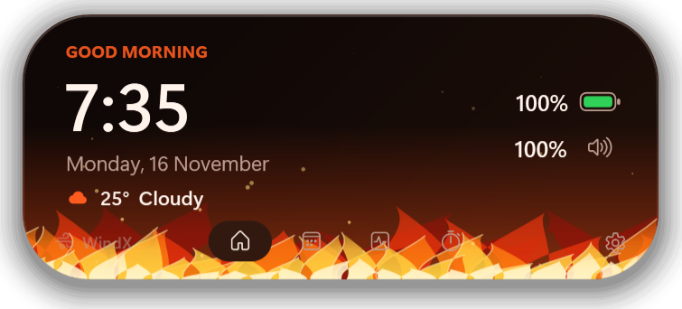

<p align="center"></p>
<h1 align="center">WindX</h1>
<p align="center"><b>A Dynamic Island for Windows.</b><br>Music, weather, calendar, timer, reminders and 24 living effects in one island at the top of your screen.</p>
<p align="center"><a href="https://be24b034-hue.github.io/windx">Website</a> · <a href="https://be24b034-hue.github.io/windx/#install">Download</a> · <a href="https://be24b034-hue.github.io/windx/privacy.html">Privacy</a></p>

<p align="center"></p>

## Features
- **Now playing** from any app, with a real audio visualizer, seek bar and album-art tint
- **24 living effects** drawn live: Fire, Water, Galaxy, Thunder, Sakura, Ribbons, Race, Rain, Snow, Aurora and more
- **26 themes** (classic, gradient and team colours), three sizes, transparency and position
- **Calendar and weather**, **system vitals**, and a CPU/RAM **game overlay**
- **Timer, Pomodoro and reminders** inside the island
- **Quick controls**: brightness, volume, Wi-Fi, Bluetooth, mute, screenshot
- Hanging note, touch sounds, your own theme music and background picture, auto-hide
- About 40 MB of memory and a fraction of a percent of CPU at rest

## Install
1. Download the zip from the [website](https://be24b034-hue.github.io/windx/#install).
2. Right-click it, **Extract All…**, then run **WindX.exe**.
3. If SmartScreen appears: **More info → Run anyway** (WindX isn't code-signed yet).
4. Right-click the island for Settings and turn on **Start with Windows**.

## Build from source
Requires the .NET 10 SDK on Windows.
```
dotnet build -c Release
```

## Privacy
No accounts, analytics or telemetry. The only network request is the optional weather forecast (Open-Meteo), and only after you enter a city. See [privacy](https://be24b034-hue.github.io/windx/privacy.html).

Team colour themes are unofficial fan themes. WindX is not affiliated with Microsoft, Apple, Formula 1, any F1 team, PUBG or Krafton.

## License
[MIT](LICENSE)
